# BlaBla

**Contracts that keep small coding models on track.**

[](https://github.com/Kiborgik/blabla/actions/workflows/release.yml)


[](https://doi.org/10.5281/zenodo.22761364)

Small coding models drift from the goal and say "done" too early. With BlaBla, a human or a strong model writes the intent once, as contracts. A cheap model does the work. BlaBla checks it and answers GREEN, YELLOW or RED, with the broken rule and the shortest failing example. No model can talk its way past RED, so strong models and people stay free for the hard calls.

```sh
cargo install blabla --locked
blabla status               # every rule's state, and what to read next
blabla explain <identity>   # one rule, its evidence, its failing example
blabla finish               # run all checks; exit 0 only when all is GREEN
```

New project: `blabla init --agents --command python ./main.py`, then `blabla guide bootstrap`. Example from a checkout: `cargo run --release --quiet --bin blabla -- --project examples/todo finish` (one [Todo contract](examples/todo.bla), apps in six languages).

## What it checks



| Layer | You write | BlaBla gives back |
| --- | --- | --- |
| Behavior | state, actions and rules the running app must keep | generated runs, the broken rule, the shortest failing steps |
| Structure | modules, symbols, dependencies and values the code must or must not have | facts read from source (Python, Rust, TS/JS, Go, Java, C, C++) without running it |
| Memory | mission, systems, roles, knowledge, goals | answers to `explain`; never decides done |
| Tasks | one bounded job: scope, check, findings, review | a record of the check result, bound to the current code |

| State | Meaning |
| --- | --- |
| GREEN | every rule was exercised and held |
| YELLOW | nothing broke, but some rule was never exercised: not done |
| RED / ERROR | a rule broke / a fact could not be read |

Done means `finish` reports OVERALL GREEN. GREEN is a bounded check, not a proof.

**Several agents.** An orchestrator opens a task with a write scope and a check. A worker accepts, edits inside the scope, runs the check and hands back. A reviewer looks for defects; the orchestrator closes and runs `finish`. BlaBla refuses a hand-back whose evidence is missing or older than the code. With `task open --falsify`, it also runs the check against the code as it was before the task and refuses a hand-back whose tests pass without the change. It records work; it does not launch agents.

**Evidence so far.** In one benchmark, Claude Haiku with BlaBla kept behavior and architecture intact on about 29% of the input tokens of a full-prose setup (one model, one project). On real projects, missing acceptance, open findings and stale evidence stayed visible until fixed. The expert layer is experimental and has shown no benefit. [Research](docs/research.md)

## Docs

| Need | Read |
| --- | --- |
| Behavior contracts and the adapter protocol | [Language](docs/language.md) |
| Structure contracts and language limits | [Structure](docs/structure.md) |
| `project.bla`, memory, identities, exit codes | [Project](docs/project.md) |
| Tasks, review and recovery | [Agent workflow](docs/agent-workflow.md) |
| Rules this project never breaks | [BLA_BLA.md](BLA_BLA.md) |
| Code map | [Architecture](docs/architecture.md) |

[Changelog](CHANGELOG.md) · [Contributing](CONTRIBUTING.md) · [Security](SECURITY.md) · [Code of conduct](CODE_OF_CONDUCT.md) · [Citation](CITATION.cff) · [MIT](LICENSE)

False GREEN reports are the most useful bug. Before 1.0, a minor release may break syntax, CLI or JSON; the changelog says how to upgrade.
