# Agent workflow

Start with `blabla status`, open what it points to with `blabla explain`, change the code, then run `blabla finish`. Never weaken a contract to get GREEN. In BlaBla's own checkout use `cargo run --release --quiet --bin blabla --`.

- **RED**: fix the broken rule; `explain` shows the shortest failing steps
- **ERROR**: make the fact readable; unknown is not absent
- **YELLOW**: reach the witness `explain` names; "nothing broke" is not enough
- **STALE, UNVERIFIED, INTERRUPTED**: run `finish` again. VERIFYING means a run is still going; wait for the real exit
- **`runtime::restart`** in a result is BlaBla's own restart; read it with `explain`, do not build it into the app

Copy identities from the output; never build them. [States and exit codes](project.md#layers-and-completion)

## The loop



| Step | Who does what |
| --- | --- |
| Plan | orchestrator reads `status`, memory and `flow::<name>`; names the change and how to accept it |
| Assign | orchestrator opens a task: role, write scope, deliverables, check, optional `--goal` |
| Accept | worker reads `task show` and accepts **before editing** |
| Implement | worker edits only inside its scope; asks or blocks when unsure |
| Verify | worker runs the exact check, reads the whole result, records evidence and one lens per consulted pack |
| Hand back | worker runs `challenge NAME`, then `task ready NAME` |
| Review | a separate reviewer reads task, diff and evidence and records findings; the worker accepts again to repair |
| Close | orchestrator resolves findings, confirms records it made during the carry, closes the task |
| Done | orchestrator runs `finish`; a closed task never replaces the project gate |

States: `OPEN → ACCEPTED → READY → CLOSED`. `BLOCKED` pauses; `WITHDRAWN` ends without credit. A READY task is accepted again before any change. BlaBla checks these steps; it does not launch agents.

```sh
blabla task open fix-cache --role worker --statement "Repair stale cache reads" \
  --scope src/cache.rs tests/cache.rs --deliverable src/cache.rs \
  --check-argv cargo test --release --test cache
blabla task accept fix-cache --model MODEL    # MODEL must be allowed by the role
blabla task evidence fix-cache --run          # runs the argv check, records its exit
blabla task lens fix-cache testing "What the check proves and what it misses"
blabla challenge fix-cache
blabla task ready fix-cache
```

Use the packs your role consults, not the ones in this example. `task show` prints the next routes for a task; `blabla task --help` lists every verb.

## Evidence that stays current

- Opening a task snapshots the tree. Each deliverable must change from that snapshot
- Live write scopes never overlap; reads may. A scope is project-relative: absolute, `..` and symlink paths are refused. Inputs and deliverables also refuse skipped and ignored paths
- Evidence covers the scope and deliverables, or the `--input` list you declare. It binds the exact check, its arguments, the acceptance epoch and the input digests. A new acceptance starts a new epoch, even for the same model
- `task evidence --run` runs an argv check from the project root with no shell and no timeout, so pick a bounded check. For a text check, run it yourself and record `--exit CODE --tool TOOL`
- READY needs current passing evidence, current lens assessments and a fresh challenge receipt. Relevant edits or findings void the receipt; unrelated work does not
- CLOSE checks it all again. Task acceptance and project verification answer different questions

| Need | Command (add `--model M` where `--help` asks) |
| --- | --- |
| note, finding, stop | `task note`, `task finding`, `task block` |
| report or resolve a fix | `task addressed NAME ID "…"` (worker); `task resolve NAME ID --evidence "…"` (orchestrator) |
| fix the check or its inputs | `task check NAME --input PATH… --argv PROG ARG…` |
| widen scope and fix the check at once | `task check NAME --add-scope PATH… --argv PROG ARG…` |
| change deliverables or scope | `task deliverable NAME --add\|--remove PATH`; `task scope NAME --add PATH` |
| withdraw | `task withdraw NAME --reason "…"`; changed paths stay challenged until restored or `task reconcile-withdrawal`, which can go stale |

Scope, check, attribution and withdrawal changes are the orchestrator's. BlaBla options go before `--argv`; `--input` replaces the whole input list. After hand-back, the orchestrator checks records it made during the carry and runs `task confirm` once before `task close`.

## Ask, don't guess

```sh
blabla task decide fix-cache "Is the cache the cause?" --pick yes --confidence 55 --model M
blabla task ask fix-cache "Is this failure in scope?" --floor 90 --model OWNER_M
blabla task decide fix-cache --on q1 --pick yes --confidence 95 --model M
```

Picks are `yes`/`no` unless `--options a,b,c` is given; confidence is 0–100. Below the role's `block_below` floor the task is BLOCKED at once: stop, and do not act on the pick. The orchestrator answers with `task answer`; the worker then accepts again. An asked question can raise the floor, never lower it, and blocks READY until it is picked.

## Review

```sh
blabla task open review-cache --role reviewer --statement "Review cache repair" \
  --review-of fix-cache --check-argv cargo test --release --test cache
```

A review binds the target's current state. If the target changes, the review is accepted, checked and challenged again. An old CLOSED review gives no current approval; open a new one. Each `task lens NAME PACK "…"` binds the model, the epoch and the pack.

`--model` and task records are claims, not authentication. Records the orchestrator makes while a worker carries a task stay unconfirmed: READY is allowed, CLOSE is refused until `task confirm`.

## Challenge

`blabla challenge NAME` reports the one strongest contradiction it can ground. With a task that is not CLOSED or WITHDRAWN it exits 0 when the hand-back is clear and 1 when it is blocked; otherwise exit 1 means a project challenge stands. It reads no code meaning; silence means no contradiction was found, not approval. Classes:

- **Task record**: `unresolved-finding`, `deliverable-unchanged`, `scope-breach`, `work-without-acceptance`, `attribution-unknown`
- **Roles and decisions**: `model-outside-role-policy`, `exception-unresolved`, `decision-unanswered`, `question-unpicked`, `orchestrator-record-during-carry`
- **Evidence**: `declared-check-failed`, `readiness-without-evidence`, `evidence-superseded`, `review-target-stale`, `lens-unassessed`, `unobservable-task-input`
- **Project**: `vacuous-rule`, `verification-not-current`, `withdrawal-residue`, `goal-outcome-unmet`

## Upgrading task records to 0.10

Back up `.blabla/tasks/` first, and never switch versions while one task is in flight. Old records stay readable but give no current credit. To earn it, accept again, rerun the exact check, assess lenses again and challenge before READY. Fix an `unobservable-task-input` with `task check NAME --input TRACKED_PATH --argv …` or `task deliverable NAME --remove`. Old reviews need an explicit `--review-of`. [Breaking notes](../CHANGELOG.md#0100-2026-10-06)

Authoring: `blabla guide bootstrap`, `guide change`, `guide memory`. Optional advice: [Expert](expert.md).
