# Architecture

Two independent pipelines, Behavior and Structure, meet in the project and report layer. Memory, task records and optional expert advice sit beside them and never decide done.



[Diagram text](diagrams/README.md#architecture) · the queryable map: `blabla explain system::<name>`

| Path | Owns |
| --- | --- |
| `src/cli/` | commands, onboarding text, progress; human and JSON output from one view |
| `src/project/` | manifest, profile, identities, fingerprints, status and run markers |
| `src/syntax/` → `src/semantics/` → `src/ir/` | parse and type-check behavior into normalized IR |
| `src/verify/` | seeded generation, coverage, evaluation and shrinking |
| `src/application.rs`, `src/runtime/` | JSON Lines boundary, per-case directory, trusted restart, timeouts, process-tree cleanup |
| `src/structure/` | structure contracts, providers (`python.rs` + `python_facts.py`, `rust.rs` with `syn`, `treesitter.rs` for TS/JS, Go, Java, C, C++), one fact evaluator, falsification |
| `src/memory/` | memory parsing, validation and knowledge routing |
| `src/project/task*` | tasks, relevant revisions, evidence and review bindings, ownership |
| `src/skeptic.rs` | one grounded challenge from records and tree; no code review |
| `src/expert/` | packets, provider transport, policy, trace and replay, calibration, native and pilot protocol |
| `src/report.rs`, `diagnostic.rs`, `voice.rs` | shared report shapes and presentation-only voice |

## Stable seams

- **`Application`**: `reset`, `call`, `observe`, `restart`, `finish`. The verifier sees observations, not processes
- **`Provider`** returns **`ModuleFacts`** for every requested module; silence is ERROR, not absence. All providers share one evaluator
- **Typed IR and `RunReport`**: coverage, failures and IDs are defined over IR; human and JSON render the same value
- **`Task` and relevant revision**: declarations, tree and evidence enter the skeptic and freshness checks here
- **Expert request, response and result**: `ExpertResult` is advice, never a verdict
- **`runtime/primitives.rs`**: the one table of runtime primitive meaning

## State and trust

```text
project.bla + registered *.bla    authored intent and contract definitions
.blabla/status.json              recorded behavior campaign and audit data
.blabla/verifying.json           in-flight process/run identity
.blabla/tasks/*.json             assignments, snapshots, findings and evidence
.blabla/expert/                  runtime settings, bounded traces, reservations and receipts
```

Behavior records are checked for freshness; structure is always checked live. Providers build facts once and the evaluator decides; falsification flips facts in memory and reruns the same evaluator. Expert calls happen only at explicit host boundaries, never inside verification.

## Self-hosting

BlaBla checks itself. `project.bla` registers its contracts and memory; the `structure-adapter` example bridges behavior contracts to the real evaluator, task, goal and expert functions. Structure rules keep the pipelines, the skeptic and the expert layer apart. The product gate rebuilds the bridge and runs `finish`. [Checks](../CONTRIBUTING.md#checks)
